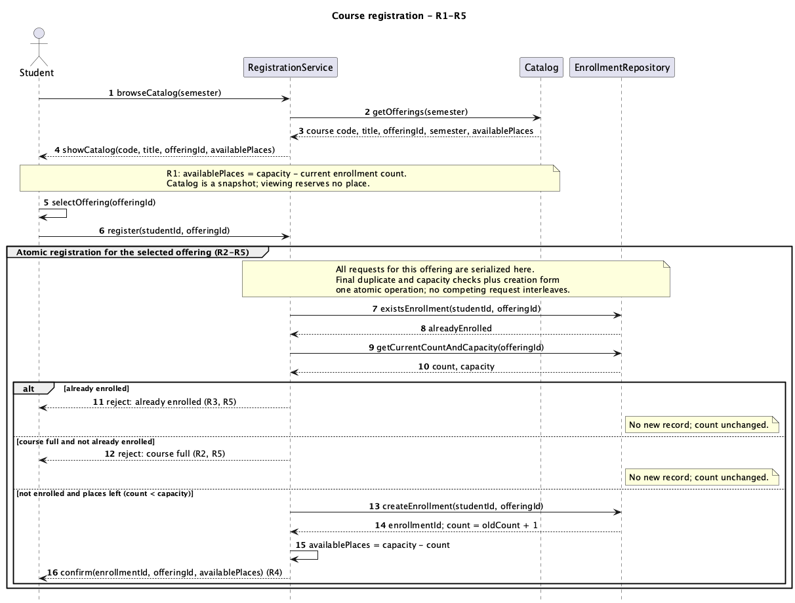
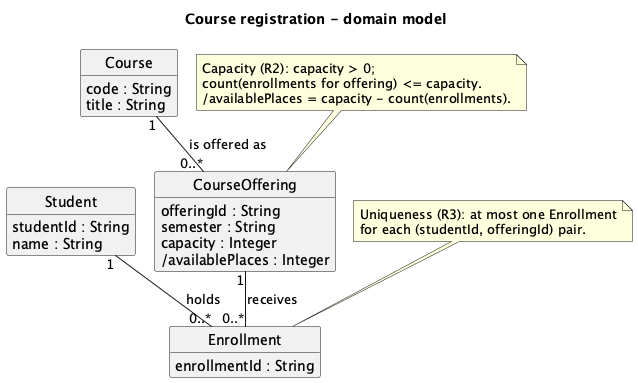

# SIS #02 — AI-Assisted UML Modeling: University Course Registration

Muratov Nurali · 24B031887 · Monday group · safarinn

> AI-assisted working draft. Technical content is completed; historical evidence and student attestations remain incomplete. Do not represent this package as a fully compliant submission yet.

## 1. Scope and assumptions

**Scope:** Model how a signed-in student browses semester offerings and requests registration, enforcing capacity, uniqueness, confirmation and clear rejection under R1-R5. Payments, prerequisites, timetable clashes, waiting lists and cancellation are out of scope.

**Assumptions:**

1. The student is signed in, the selected offering exists, and capacity is a positive integer, as the scenario states.
2. Every request affecting an offering participates in the same atomic registration operation; browsing does not reserve a place.
3. A course can exist with no scheduled offering. Offering identifiers are unique; availability is derived from current enrollments.
4. Duplicate rejection takes priority when a student is already enrolled and the offering is also full. This is a modeling choice, not an added university policy.

Status: AI-assisted draft for student review; this is not evidence of a student-written pre-AI baseline.

## 2. User stories and acceptance criteria

### US-01 — Browse offerings

**US-01:** As a student, I want to browse offerings for one semester, so that I can choose a specific section with visible availability.

- **AC-01** (R1): Given offerings exist for the selected semester, When I browse the catalog, Then each row shows course code, title, offering identifier and available places for that semester only.
- **AC-02** (R1): Given offering CS101-A has capacity 2 and one enrollment, When I view its catalog row, Then it shows one available place and viewing the row reserves no place.

### US-02 — Register for an offering

**US-02:** As a student, I want to register for my selected offering, so that I obtain one confirmed enrollment when a place is available.

- **AC-03** (R2, R3, R4): Given I have no enrollment in an offering with capacity 2 and count 0, When I request registration, Then the system atomically rechecks duplicates and current capacity, creates exactly one Enrollment linking me to that offering, changes count to 1 and available places to 1, and returns confirmation after creation.
- **AC-04** (R2, R3, R4): Given two different students without enrollments request the last place in an offering with capacity 2 and count 1, When their registration requests compete, Then atomic checks and creation admit exactly one, its confirmation reports zero remaining places, and the other receives course full without another Enrollment.

### US-03 — Receive a clear rejection

**US-03:** As a student, I want a clear reason when registration is rejected, so that I know whether the offering is full or I am already enrolled.

- **AC-05** (R2, R5): Given the catalog showed a place but current count is now 2 of capacity 2 and I am not enrolled, When I request registration, Then the final current-capacity check returns course full, creates no Enrollment and leaves count at 2.
- **AC-06** (R3, R5): Given I already have an Enrollment in an offering with capacity 2 and count 1, When I request the same offering again, Then the final duplicate check returns already enrolled, creates no Enrollment and leaves count at 1.

## 3. Sequence diagram

**Participants:** Student is the signed-in requester. RegistrationService coordinates browsing and registration. Catalog provides a semester snapshot. EnrollmentRepository represents access to current registrations and creation of Enrollment records.

**Atomic operation:** The Atomic registration group includes existsEnrollment, getCurrentCountAndCapacity and createEnrollment. All requests for the same offering are serialized across these checks and creation. Thus a second contender observes the first contender's newly increased count. A catalog snapshot reserves nothing and cannot authorize creation.

**Where the Enrollment is created:** RegistrationService sends createEnrollment(studentId, offeringId) to EnrollmentRepository in the success branch. It produces exactly one instance of the Enrollment class, linked to the requested Student and CourseOffering. The returned enrollmentId identifies this object. Confirmation follows creation.

**Technical lifelines:** RegistrationService, Catalog and EnrollmentRepository describe interaction responsibilities rather than domain concepts. Their absence from the domain class diagram is intentional. No particular database or framework is prescribed.

## 4. Class diagram

| Association | Read left to right | Read right to left |
| --- | --- | --- |
| Student — Enrollment | One Student holds zero or many Enrollments. | Each Enrollment belongs to exactly one Student. |
| CourseOffering — Enrollment | One CourseOffering receives zero or many Enrollments. | Each Enrollment belongs to exactly one CourseOffering. |
| Course — CourseOffering | One Course has zero or many CourseOfferings. | Each CourseOffering describes exactly one Course. |

**How an Enrollment links a student to an offering:** Its two associations each have multiplicity 1 at the referenced domain object. The service uses studentId and offeringId to resolve these objects, and the resulting Enrollment stores the relationship.

**Capacity constraint:** For each offering, count(enrollments) <= capacity, capacity > 0, and availablePlaces = capacity - count(enrollments). A static 0..* multiplicity cannot bind its upper limit to an individual offering's capacity attribute.

**Uniqueness constraint:** For each (studentId, offeringId) pair there is at most one Enrollment. Both links may individually satisfy their multiplicities even if two Enrollment objects connect the same pair, so a separate pair constraint is necessary.

## 5. Traceability

| Rule and criterion | Model evidence | Validation case |
| --- | --- | --- |
| R1 + AC-01, AC-02 | getOfferings(semester), showCatalog and the snapshot note expose all required catalog fields; Course has code/title. | Extra inspection: CS101, Introduction to Computing, CS101-A, Fall 2026, capacity 2/count 1 yields one available place without a state change. |
| R2 + AC-03, AC-04, AC-05 | getCurrentCountAndCapacity follows register inside the Atomic registration group; success guard requires count < capacity; capacity note limits all offerings. | T1, T2, T3; interleaving check: second contender reads count 2 after first contender commits. |
| R3 + AC-03, AC-04, AC-06 | existsEnrollment precedes creation; already enrolled guard rejects; uniqueness note limits pairs. | T4 |
| R4 + AC-03, AC-04 | createEnrollment occurs once on success; derived availability precedes confirm. | T1, T2 |
| R5 + AC-05, AC-06 | Both rejection branches return explicit reasons and contain no writes. | T3, T4 |

## 6. Walkthroughs

These are actual assistant-performed traces of the final sources, not claims of independent student work. The student must repeat and review them before submission. Common prefix: browseCatalog -> getOfferings -> showCatalog -> selectOffering -> register.

| Case | Observed path and state change | Judgment and evidence |
| --- | --- | --- |
| T1. Available | After the common prefix, existsEnrollment returns false; getCurrentCountAndCapacity returns 0 and 2. The success branch calls createEnrollment once; count changes 0 -> 1; availablePlaces becomes 1; confirm returns the enrollment identifier. | Pass — success guard count < capacity, createEnrollment and confirm messages. |
| T2. Last place | After the common prefix, existsEnrollment returns false; current count is 1 and capacity is 2. The success branch creates one Enrollment; count changes 1 -> 2 and availability becomes 0 before confirmation. A later contender reads count 2. | Pass — Atomic registration group and success guard prevent an interleaving creation. |
| T3. Full | showCatalog previously showed one place. After register, existsEnrollment is false but getCurrentCountAndCapacity returns count 2 and capacity 2. The course full branch returns its reason without creating a record; count remains 2 -> 2. | Pass — course full and not already enrolled guard, reject: course full message. |
| T4. Duplicate | After register, existsEnrollment returns true for the same pair; getCurrentCountAndCapacity returns count 1 and capacity 2. The already enrolled branch returns its reason; no creation occurs and count remains 1 -> 1. | Pass — already enrolled guard and reject: already enrolled message. |

## 7. Review decisions

The following are assistant review recommendations applied to this draft, awaiting the student's own decisions. No independent Prompt C chat was run.

| AI suggestion or model element | Decision | Reason | Rule |
| --- | --- | --- | --- |
| Atomic group contains checks and creation | Accepted: preserve the complete atomic boundary. | A fresh capacity read alone cannot stop another request from taking the same last place. | R2, R4 |
| Course has zero or many offerings | Accepted: keep 0..* and record the assumption. | The scenario does not require every catalog course to be scheduled in every semester. | R1 |
| Explicit duplicate branch before full branch | Accepted: preserve duplicate priority and explain it. | An existing enrollment gives the requester a more specific explanation when both rejection conditions hold. | R3, R5 |
| Add database locking classes | Rejected: keep the domain model limited to four classes. | The atomicity requirement can be stated without introducing implementation mechanisms outside the assignment's abstraction. | R2 |
| Derived availablePlaces | Accepted: keep the derived attribute and recalculate after creation. | A derived value avoids two independent counts that could contradict each other after registration. | R1, R4 |
| W2: personal reflection | Unresolved: awaiting the student's own account. | A first-person account of personal learning cannot be verified from an empty template. | R1-R5 |
| A1: pre-AI baseline | Unresolved: no authentic initial assumptions were supplied. | The student's earlier scope and assumptions cannot be reconstructed as historical evidence. | R1-R5 |
| E1, E2, E3, E4, E5, E6, E7, E8, E9, E10: AI exchange evidence | Unresolved: four required exchanges were not conducted. | This completion conversation does not establish four exact prompts or an independent critique chat. | R1-R5 |

## 8. Modeling explanation

The domain model separates a Course from a CourseOffering because registration targets a particular section in a particular semester, rather than an abstract subject. Course stores the reusable code and title. CourseOffering stores its identifier, semester, capacity, and derived available places. Enrollment represents the relationship between exactly one Student and exactly one CourseOffering, with an identifier suitable for the confirmation.

The associations allow a student and an offering to have many enrollments, but they do not encode every business restriction. The capacity note limits the number of enrollments associated with each offering according to that offering's capacity. The uniqueness note restricts each student and offering pair to one enrollment. These are separate constraints because a fixed multiplicity cannot express a variable capacity or distinguish pairs across enrollment objects.

The sequence diagram complements this structural view by showing when the restrictions are evaluated. Catalog browsing returns a snapshot without reserving anything. Registration reads current duplicate and capacity information inside an atomic operation shared by all requests for the selected offering. A successful request creates one Enrollment before returning confirmation. The two rejection branches return distinct reasons without changing the count. Available places are derived again after successful creation, avoiding an independently maintained counter.

An activity diagram could additionally emphasize the decision flow from selection through duplicate and capacity decisions to confirmation or rejection. It would help compare paths, while the sequence diagram remains better suited to locating messages and responsibilities. Neither diagram implements the concurrency mechanism; atomicity is an explicit required behavior, not a demonstrated database implementation.

## 9. Reflection

Personal reflection is awaiting the student's own account. This assistant has not supplied a first-person reflection or claimed to know the student's independent decisions. Describe the specific help received, one decision personally evaluated, and a remaining limitation in 150-200 words. Any later translation or editing assistance must be disclosed.

## 10. Appendix A — Before AI

**Scope:** No student-written scope statement recorded before AI was supplied. This chronology cannot be recreated retroactively or represented as a pre-AI commit.

**Initial assumptions:**

No initial assumptions authored by the student before AI were supplied. The final assumptions in section 1 were prepared with AI assistance on 2026-10-18. Restore an authentic earlier baseline only if it exists; otherwise disclose the deviation.

## 11. Appendix B — AI exchanges

The user requested completion of the assignment in one Codex conversation on 2026-10-18. The exact initial request was: «заверши мне этот сис». The user later supplied identity and repository details. No four separate Prompt A-D exchanges were provided or executed, and no independent critique chat was run. This section deliberately does not invent a transcript. The generated report and PlantUML files are the assistant's actual deliverables from that conversation. Tool: Codex desktop. Model version displayed to the assistant: not displayed.

Required process evidence remains outstanding. The four exact prompt templates are in README.md section 4. Any subsequent exchanges must be logged verbatim and dated when they actually occur; they must not be described as preceding this draft.

## 12. Appendix C — Original diagrams

The files below preserve this assistant's first renderable diagrams. They were generated from the user's completion request, not from a separately executed Prompt B. Final files currently retain the same substantive design. Literal line breaks in quoted PlantUML notes were corrected to escaped line breaks during rendering; no domain semantics changed.

## 13. Appendix D — References and source checks

### References

- PlantUML. Sequence diagram syntax and features. Section “Grouping message”. https://plantuml.com/sequence-diagram (accessed by the assistant 2026-10-18).
- PlantUML. Class diagram syntax and features. Section “Label on relations”. https://plantuml.com/class-diagram (accessed by the assistant 2026-10-18).

### Source checks

These sources were actually opened by the assistant. Student verification is not yet attested.

| Modeling decision | Source and locator | What the source says | How it supports or changed your model |
| --- | --- | --- | --- |
| Group alternative registration outcomes and mark the atomic boundary | PlantUML, Sequence diagram, section Grouping message, https://plantuml.com/sequence-diagram ; accessed 2026-10-18 | alt/else, critical and group form message groups, closed with end; groups can be nested. | The model nests guarded alternatives within an explicitly atomic group. Atomic business semantics are stated in the note, not inferred from drawing syntax. |
| Put multiplicities at both association ends | PlantUML, Class diagram, section Label on relations, https://plantuml.com/class-diagram ; accessed 2026-10-18 | Cardinalities are placed in double quotes at either end of a relation, and labels follow a colon. | Each of the three domain associations has two quoted multiplicities and a readable label; capacity and pair uniqueness remain separate business constraints. |

